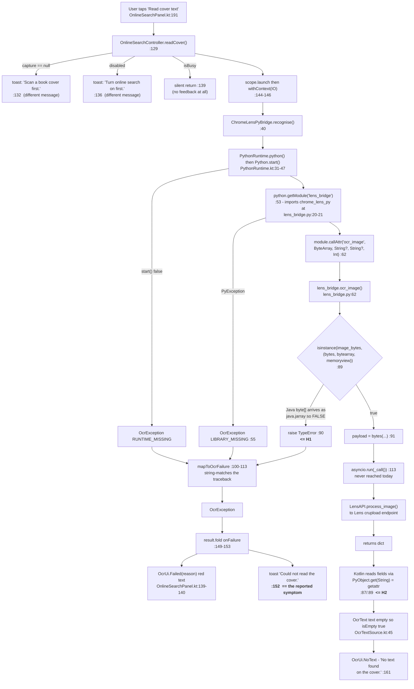

# Online Cover Recognition — Diagnostic Report

**Symptom under investigation:** the app reports **“Could not read the cover.”** every time the
online cover-recognition step is used.

**Status: diagnostic only. No application code, build file, manifest or configuration was changed
while producing this report.** See §14 for exactly what was and was not done.

> ### ✅ Resolved — 2026-10-21
>
> **H1 and H2 were both confirmed and fixed.** See **§15 Resolution** at the end of this document
> for what changed, what was verified, and what remains unverified. The headline: H1 was confirmed
> at the artifact level (the shipped native runtime defines the Python type `java.chaquopy.jarray`),
> H2 was confirmed from the Chaquopy Javadoc, and a third defect (H6, the discarded
> `Bitmap.compress()` result) was fixed alongside them. Test count went from 84 to **110**, all
> passing. **Live OCR on a device is still unverified** — no device was available.

---

## 1. Executive summary

The message **“Could not read the cover.”** is produced at exactly one place —
`OnlineSearchController.kt:152` — and it is emitted for **every** exception raised anywhere in the
OCR path, with no distinction between an image problem, a Python failure, an import failure or a
network failure. The specific reason is never shown in the toast; it is only written into
`OcrUi.Failed`, which the panel renders as small red text (`OnlineSearchPanel.kt:139-140`).
A generic message alone would normally be weak evidence. Here it is not needed, because two defects
are provable from the source plus the runtime vendor’s own documentation.

**Primary finding (H1).** `app/src/main/python/lens_bridge.py:89-90` rejects the image before doing
any work:

```python
if not isinstance(image_bytes, (bytes, bytearray, memoryview)):
    raise TypeError("image_bytes must be raw picture bytes")
```

Kotlin passes a `ByteArray` (`ChromeLensPyBridge.kt:62`). Chaquopy’s documentation states
**“A Java array is represented by a `jarray` object”** and, for exactly this use case,
**“`content` is already a bytes-like object, but if you need a standard `bytes` object:
`content = bytes(content)`”**. A `java.jarray` is a buffer-protocol proxy; it is **not** an instance
of `bytes`, `bytearray` or `memoryview`. The guard therefore fails on **every** call, raising
`TypeError`, which `mapToOcrFailure` cannot classify (`ChromeLensPyBridge.kt:102-111` matches only
`Lens*` names) and so buckets as `OcrFailure.LIBRARY` → toast **“Could not read the cover.”**
This is deterministic and matches “whenever I attempt to use it”.

The defect is self-evidently accidental: the very next line, `payload = bytes(image_bytes)`
(`lens_bridge.py:91`), is precisely the conversion the vendor documents.

**Secondary finding (H2), latent behind H1.** `ChromeLensPyBridge.kt:87/89` read the result dict with
`PyObject.get(String)`. The Chaquopy Javadoc for that method says verbatim: **“Equivalent to Python
`getattr()`. … when the attribute does not exist, this method returns `null` rather than throwing an
exception.”** A Python `dict` has no attribute named `text`, so **every** field read comes back
`null` → `""` / `0`. Even with H1 fixed, `OcrText.text` would be empty, `OcrText.isEmpty`
(`OcrTextSource.kt:45`) would be true, and the app would report **“No text found on the cover.”**
instead. H2 also degrades the bridge status line, which is **checkable on the device right now
without any logging** — see §2.3.

**Consequence.** H1 blocks the call before `asyncio.run()` (`lens_bridge.py:113`) is ever reached,
so the event-loop, network and Lens-request stages have **never executed** in this build. They remain
unverified, not verified-and-working.

**Why the test suite is green.** All 84 unit tests pass, but none touch the Kotlin↔Python boundary.
`OnlineSearchTest.kt` covers only `OcrQueryExtractor` and `OpenLibraryResponseParser` — pure JVM
logic. The bridge, the Python module and the Chaquopy type mapping have **zero** test coverage, which
is exactly the gap both defects fell through.

---

## 2. Confirmed symptoms and reproduction

### 2.1 User-reported (not independently reproduced)
- Using the online feature produces **“Could not read the cover.”**
- It happens **every time**.

**I could not reproduce this.** `adb devices` returns an empty list — no device or emulator is
attached to this environment — and no Logcat capture was supplied. Every statement below about
*runtime* behaviour is therefore an inference from source plus vendor documentation, and is labelled
as such.

### 2.2 Reproduction path (from source)
1. Panel **2.5 · Online search** → toggle **Use online services** on
   (`OnlineSearchPanel.kt` switch → `OnlineSearchController.setEnabled`, line 70).
2. Capture a cover (camera / Auto Scan / picked photo) → `MainViewModel.applyCapture`
   (`MainViewModel.kt:255-261`) → `codec.encodeJpeg(...)` → `online.onCapture(forOcr)`.
3. `OnlineSearchController.onCapture` (line 122) stores the bytes and calls `readCover()` (line 129).
4. `readCover` → `bridge.recognise(...)` on `Dispatchers.IO` (line 145) →
   `ChromeLensPyBridge.recognise` → `module.callAttr("ocr_image", imageBytes, …)` (line 62).
5. `lens_bridge.ocr_image` raises `TypeError` at line 90 → `PyException` → `mapToOcrFailure` (line 65).
6. `result.fold(onFailure = …)` → `_ui.update { ocr = OcrUi.Failed(reason) }` and
   `onMessage("Could not read the cover.", ToastKind.ERR)` (lines 151-152).

### 2.3 Two checks that need nothing beyond the running app
These distinguish H1 from H2/H4 without any instrumentation, and should be done first:

| Check | Expected if the hypothesis holds |
| :--- | :--- |
| **a.** Read the small **red text** inside panel 2.5 after a failure (`OnlineSearchPanel.kt:139-140`). | Contains `TypeError: image_bytes must be raw picture bytes` → **H1 confirmed**. Contains `ImportError`/`ModuleNotFoundError` → H4. Contains `LensConnectionError` → H5. |
| **b.** Read the **green bridge status line** (`OnlineSearchPanel.kt:118`, format `"${bridge.library} ${bridge.version} · OCR only, no product search"`). | Renders as **“· OCR only, no product search”** with empty name and empty version → **H2 confirmed** (the dict reads return `null`). Reads “chrome-lens-py 3.8.2 · …” → H2 is wrong about `availability()` and must be re-examined. |

Check (b) is available the instant the panel is switched on, before any capture.
---

## 3. Relevant project structure and file/function references

```
app/src/main/
├─ java/com/bookcovermatcher/
│  ├─ MainViewModel.kt              applyCapture() ......... 234-262  [image source + hand-off]
│  ├─ UiState.kt                    val online .................... 87
│  ├─ OnlineSearchUi.kt             OcrUi / BridgeUi / CatalogueUi  [state types]
│  ├─ vision/AndroidImageCodec.kt   encodeJpeg() ......... 105-127    [the only conversion]
│  ├─ online/
│  │  ├─ OnlineSearchController.kt  onCapture 122 | readCover 129 | toast 152
│  │  │                             applyOcrText ........... 158-180
│  │  │                             checkBridge ............ 94-107
│  │  ├─ ChromeLensPyBridge.kt      recognise ................ 40-77
│  │  │                             string()/integer() ....... 87-89   << H2
│  │  │                             mapToOcrFailure ....... 100-113
│  │  ├─ PythonRuntime.kt           start()/python() ......... 31-47
│  │  ├─ OcrTextSource.kt           OcrText.isEmpty ............. 45
│  │  ├─ OpenLibraryBooksSource.kt  (step B - separate service)
│  │  └─ HttpJsonClient.kt          (step B only; not in the OCR path)
│  └─ ui/OnlineSearchPanel.kt       BridgeLine 115-131 | OcrSection 134-198
└─ python/lens_bridge.py            ocr_image .............. 62-143
                                    isinstance guard .... 89-90         << H1
                                    asyncio.run ............. 113
```

**Call chain:** `OnlineSearchPanel` → `OnlineSearchController.readCover` →
`ChromeLensPyBridge.recognise` → Chaquopy `callAttr` → `lens_bridge.ocr_image` →
`chrome_lens_py.LensAPI.process_image`.

**Not in this path:** `HttpJsonClient`, `OpenLibraryBooksSource`, `CoverImageLoader` and
`OcrQueryExtractor` belong to step B (catalogue search) and cannot produce this message.

---

## 4. End-to-end execution flow



---

## 5. Image-data flow and type-conversion table

| # | Stage | Code | In → Out | Verified? |
| :- | :--- | :--- | :--- | :--- |
| 1 | Camera preview frame | `CameraController.grabGuideFrame()` | `ImageProxy` → `PixelImage` (ARGB `IntArray`) | offline path, in use |
| 2 | Gallery pick | `MainViewModel.onImagePicked` `:301` | `Uri` → bytes → `PixelImage` (EXIF applied) | offline path, in use |
| 3 | Auto Scan frame | `onAutoTick` `:281` | `PixelImage` | offline path, in use |
| 4 | **All three converge** | `applyCapture(image, auto)` `:234` | `PixelImage` | single funnel — good |
| 5 | Offline thumbnail | `makeThumbJpeg(image, 224, 304)` `:66` | `PixelImage` → JPEG `ByteArray` | **works today** |
| 6 | **Online copy** | `encodeJpeg(image, 1280)` `:105` | `PixelImage` → box-resize → `Bitmap` ARGB_8888 → JPEG q84 | **never proven to run** |
| 7 | Hand-off | `MainViewModel.kt:257-260` | `ByteArray`, or `null` on exception (silently) | guarded by `runCatching` |
| 8 | Store | `onCapture` `:122-126` | `capture = jpegBytes` | — |
| 9 | Bridge call | `callAttr(...)` `:62` | Kotlin `ByteArray` → **Python `java.jarray`** | **vendor-documented; breaks the H1 guard** |
| 10 | Guard | `lens_bridge.py:89` | `isinstance(..., (bytes,bytearray,memoryview))` → **False** | **H1** |
| 11 | Intended conversion | `lens_bridge.py:91` | `bytes(jarray)` → real `bytes` (signed→unsigned per vendor docs) | never reached |
| 12 | Result read-back | `:87` `obj.get(key)` | Python `dict` → **`getattr`** → `null` | **H2** |

**Further conversion risks visible in the source (not runtime-confirmed):**

- `encodeJpeg` **ignores the `Boolean` returned by `Bitmap.compress()`** (`AndroidImageCodec.kt:116`).
  A failed compression yields a zero-length array, which `lens_bridge.py:93` turns into
  `ValueError("The image is empty.")` → also bucketed as `LIBRARY` → the same generic toast.
- `encodeJpeg` builds an `ARGB_8888` bitmap and never flattens alpha, unlike the offline thumbnail
  path which composites onto a background (`makeThumbJpeg`, `:74`). If a capture source ever produced
  non-opaque alpha, JPEG would flatten onto black. Camera frames are opaque in practice, so this is a
  **possibility, not a confirmed defect**.
- `runCatching` at `MainViewModel.kt:257` swallows any `encodeJpeg` failure and leaves `capture`
  unset — that produces “Scan a book cover first.”, a *different* message, so it is **not** the
  reported symptom.
- No dimension, byte-count or format value is logged anywhere along this path (§9).

---

## 6. Where the generic message comes from

`OnlineSearchController.kt:147-154`:

```kotlin
result.fold(
    onSuccess = { text -> applyOcrText(text) },
    onFailure = { e ->
        val reason = (e as? OcrException)?.message ?: e.message ?: "The Lens bridge failed."
        _ui.update { it.copy(ocr = OcrUi.Failed(reason)) }    // specific: small, red, in-panel
        onMessage("Could not read the cover.", ToastKind.ERR) // generic: what the user reads
    },
)
```

**One message, many causes.** All of these funnel into it:

| Cause | Origin | `OcrFailure` bucket |
| :--- | :--- | :--- |
| Interpreter will not start | `PythonRuntime.kt:38-42` | `RUNTIME_MISSING` |
| `chrome_lens_py` / Pillow / httpx / protobuf import fails | `ChromeLensPyBridge.kt:54-56` | `LIBRARY_MISSING` |
| **`TypeError` from the `isinstance` guard (H1)** | `lens_bridge.py:90` | `LIBRARY` |
| `ValueError` empty / oversized image | `lens_bridge.py:93/95` | `LIBRARY` |
| Any `Lens*Error` | mapped by name, `:103-107` | specific |
| TLS / DNS from inside Python | `LensConnectionError` | `NETWORK` |
| Anything else from Python | fall-through, `:110` | `LIBRARY` |

The mapping at `:102-111` is **string matching against the traceback text**, so any exception whose
name is not one of the seven hard-coded strings is silently reported as a generic library failure.
That is a diagnosability defect in its own right — it is why this bug produced a useless message
instead of a precise one. Note also that `OcrUi.NoText` (“No text found on the cover.”) and
`OcrUi.Failed` are distinct states, so the two defects in this report are expected to produce
**different** user-visible strings; that difference is the cheapest discriminator available (§2.3).

---

## 7. Ranked root-cause hypotheses

### H1 — The `isinstance` guard rejects the Java byte array  **(primary)**
1. **Hypothesis.** Kotlin passes a `ByteArray`; Chaquopy delivers it to Python as a `java.jarray`
   buffer-protocol proxy, which is not an instance of `bytes`, `bytearray` or `memoryview`. The guard
   at `lens_bridge.py:89` therefore raises `TypeError` on **every** call, before any work is done.
2. **Relevant code.** `app/src/main/python/lens_bridge.py:89-91`; caller
   `online/ChromeLensPyBridge.kt:62`; classifier `ChromeLensPyBridge.kt:102-111`; message
   `OnlineSearchController.kt:152`.
3. **Evidence for.**
   - Chaquopy docs, *Python API → Types*: “**A Java array is represented by a `jarray` object.**”
   - Chaquopy docs, *FAQ → Read files from external storage*: passes
     `contentResolver.openInputStream(uri)!!.use { it.readBytes() }` via `callAttr("process", content)`,
     then says “`content` is **already a bytes-like object, but if you need a standard `bytes` object**:
     `content = bytes(content)`” — i.e. it is *not* a `bytes`.
   - Chaquopy docs, *Python API → Arrays*: “Java arrays of `boolean`, `byte`, `short`, `int`, `long`,
     `float` and `double` all implement the **Python buffer protocol**” — buffer ≠ `bytes` subclass.
   - `java/primitive.pyc` and `java/__init__.pyc` inside the shipped `assets/chaquopy/bootstrap.imy`
     contain `jarray` / `jbyte`, confirming the proxy type is present in this exact build.
   - The failure is deterministic, matching “whenever I attempt to use it”.
   - `TypeError` matches none of the seven strings in `mapToOcrFailure`, so it lands in the generic
     `LIBRARY` bucket — matching the *generic* message the user sees.
4. **Evidence against.** None found. H1 is wrong only if Chaquopy special-cases `byte[]` into real
   `bytes` when crossing `callAttr`, which contradicts the FAQ wording quoted above.
5. **Confidence.** **High** — effectively confirmed by vendor documentation and source; not marked
   *Confirmed* only because no device was available to observe the raised exception.
6. **Impact.** Prevents **all** online cover recognition, on every device and every image.
7. **Confirmation method (smallest safe check).** Read the red in-panel text (§2.3a). It is built from
   `firstLine(e.message)` and will contain `TypeError: image_bytes must be raw picture bytes`.
   No code change required.
8. **Required evidence.** The `PyException.getMessage()` string, or Logcat `python.stderr`.
9. **Dependencies.** A device or emulator running the current build. No network needed — the guard
   fires before any request.

### H2 — `PyObject.get(String)` is `getattr`, not dict lookup  **(latent, guaranteed)**
1. **Hypothesis.** `ChromeLensPyBridge` reads the returned Python `dict` with `obj.get(key)`, which is
   `getattr()`. A `dict` has no attribute called `text`, so every field reads as `null` → `""`/`0`.
2. **Relevant code.** `online/ChromeLensPyBridge.kt:87` (`string`), `:89` (`integer`), used at
   `:69-76` and in `availability()` at `:31`.
3. **Evidence for.**
   - Chaquopy Javadoc, `PyObject.get`, verbatim: “`public PyObject get(@NotNull Object key)` —
     **Equivalent to Python `getattr()`.** In accordance with the `Map` interface, when the attribute
     does not exist, this method **returns `null`** rather than throwing an exception.”
   - The same Javadoc lists `put` as `setattr()`, `remove` as `delattr()`, `keySet` as `dir()`,
     `containsKey` as `hasattr()` — the whole `Map` facade is attribute-based, not item-based.
   - The Chaquopy *Java API* examples use **`.asMap().get("HELLO")`** for `os.environ["HELLO"]`,
     i.e. `asMap()` is required for item lookup. `asMap()` appears nowhere in this project.
   - `javap` on the shipped `chaquopy_java-17.1.0.jar` shows only `get(Object)` — there is no separate
     item-lookup method to fall back on.
4. **Evidence against.** None. Note this defect produces **“No text found on the cover.”**, not the
   reported message, so it cannot be the whole story — it is masked by H1 today.
5. **Confidence.** **High** for the mechanism; **unverified** as to whether the user has ever seen its
   symptom, because H1 fires first.
6. **Impact.** Once H1 is fixed, recognition would still always report “no text”, and the bridge status
   line would show an empty library name/version.
7. **Confirmation method.** §2.3b — read the green bridge line; an empty name/version is positive
   confirmation with no code change.
8. **Required evidence.** The rendered text of `OnlineSearchPanel.kt:118`, or the raw value of
   `string(out, "text")` at `:69`.
9. **Dependencies.** Device only.

---

### H3 — `asyncio.run()` misbehaves under Chaquopy  **(unverified, currently unreachable)**
1. **Hypothesis.** `asyncio.run(_call())` (`lens_bridge.py:113`) fails on Android — event-loop
   construction, selector/epoll availability, or interaction with Chaquopy’s GIL/thread model.
2. **Relevant code.** `lens_bridge.py:100-113`; `PythonRuntime.kt:31-44` (interpreter started on a
   `Dispatchers.IO` thread).
3. **Evidence for.** It has **never executed** in this build (H1 raises first), so it is entirely
   untested. Chaquopy’s *Cross-language issues* page warns: “`threading.main_thread` will return the
   thread on which Python was started. Depending on your app’s structure, this might not be the same as
   the main thread in Java.” Our interpreter starts on an IO pool thread, so Python’s “main thread” is
   an arbitrary pool thread.
4. **Evidence against.** `asyncio.run()` installs signal handlers only when explicitly asked
   (`interrupt_signal`), so the usual “signal only works in main thread” failure does not apply by
   default. The shipped CPython target contains `lib-dynload/arm64-v8a/_asyncio.cpython-312.so`,
   `_socket.cpython-312.so`, `select.cpython-312.so` and `_ssl.cpython-312.so` (verified by listing
   `target-3.12.15-0-arm64-v8a.zip`), so the event loop, socket, selector and TLS primitives all
   exist for this ABI. Chaquopy also states it is thread-safe.
5. **Confidence.** **Unverified.**
6. **Impact.** Would prevent all recognition, but only *after* H1 is removed.
7. **Confirmation method.** After H1 is fixed, capture `python.stderr` on a failed run; a loop or
   selector error will name itself.
8. **Required evidence.** Logcat `python.stderr` / `python.stdout` during one attempt.
9. **Dependencies.** Device; H1 resolved first.

### H4 — Import-time failure of `chrome_lens_py` or a dependency  **(unverified)**
1. **Hypothesis.** `from chrome_lens_py import LensAPI` (`lens_bridge.py:20-21`) runs at module import
   and pulls in Pillow (native), `httpx`, `google.protobuf` and `rich`; one fails to import on device,
   so `getModule` throws and recognition cannot start.
2. **Relevant code.** `lens_bridge.py:20-21`; `ChromeLensPyBridge.kt:52-56`; `app/build.gradle.kts`.
3. **Evidence for.** Pillow is the only native dependency and arrives as a Chaquopy prebuilt wheel
   (`pillow-11.0.0-0-cp312-…-android_24_arm64_v8a.whl`); native wheels are where Android imports
   usually break. `protobuf` is deliberately pinned to 6.33.6 for wheel-shape reasons, so a resolution
   slip is plausible.
4. **Evidence against.** The built APK demonstrably contains `chrome_lens_py/` (84 files), `PIL`,
   `httpx`, `protobuf-6.33.6`, `rich` and `filetype` in `assets/chaquopy/requirements-common.imy`, plus
   Pillow natives in `requirements-arm64-v8a.imy`. Also an import failure would surface as a **red**
   bridge dot with an explicit reason (`OnlineSearchPanel.kt:119`), which was not reported.
5. **Confidence.** **Low–medium**, pending §2.3b.
6. **Impact.** Would prevent all recognition.
7. **Confirmation method.** Read the bridge line colour/text; then Logcat for `ModuleNotFoundError`.
8. **Required evidence.** `PyException` message from `getModule`.
9. **Dependencies.** Device only.

### H5 — Network/TLS from inside Python  **(unverified, currently unreachable)**
1. **Hypothesis.** The Lens request fails at the socket/TLS layer from within Python even though the
   Kotlin-side catalogue client works, because Chaquopy’s `ssl` uses its **own bundled certifi CA
   bundle, not the Android system store** (vendor-documented).
2. **Relevant code.** `lens_bridge.py:100-110`; contrast `online/HttpJsonClient.kt` (system TLS).
3. **Evidence for.** Vendor docs, *Python standard library → ssl*: “The `ssl` module is configured to
   use a copy of the CA bundle from certifi … **The system CA store is not used.**” Two TLS stacks in
   one app is a classic asymmetry.
4. **Evidence against.** A TLS failure would be wrapped by `chrome-lens-py` as `LensConnectionError`
   and mapped to `OcrFailure.NETWORK` (`:106`), producing the specific message “Google Lens could not
   be reached…”, not the generic one.
5. **Confidence.** **Low**, and unreachable behind H1.
6. **Impact.** Environment-dependent, not universal.
7. **Confirmation method.** Logcat during one attempt; check whether the message names
   `LensConnectionError`.
8. **Required evidence.** The wrapped exception name.
9. **Dependencies.** Device + network. **No new external requests were made for this report.**

### H6 — `Bitmap.compress()` failure yields an empty array  **(real defect, unverified symptom)**
1. **Hypothesis.** `encodeJpeg` ignores `compress()`’s return value (`AndroidImageCodec.kt:116`); on
   failure it returns a zero-length array, and `lens_bridge.py:93` raises `ValueError("The image is
   empty.")` → generic toast.
2. **Evidence for.** The `Boolean` is genuinely discarded; the resulting message is indistinguishable
   in the UI. `encodeJpeg` is new code with no test coverage.
3. **Evidence against.** The near-identical `makeThumbJpeg` (`:66-97`) uses the same API and works in
   the shipping offline flow, so `compress()` failing consistently is unlikely.
4. **Confidence.** **Low** as the root cause; **confirmed as a silent-failure defect**.
5. **Impact.** Would affect all cases if it triggered; otherwise none.
6. **Confirmation method.** Log `forOcr.size` at `MainViewModel.kt:258` (during the fix phase).
7. **Required evidence.** Byte count and dimensions of the encoded JPEG.

---

### H7 — `capture` never populated when the panel is enabled after a scan
`MainViewModel.kt:257` calls `online.onCapture(...)` only when the panel is *already* enabled, so
scanning first and enabling later leaves `capture == null` → **“Scan a book cover first.”**
(`OnlineSearchController.kt:130-134`). **Confirmed as a defect; eliminated as the cause of this
symptom** because the resulting message differs.

### H8 — Silent no-op while busy
`OnlineSearchController.kt:139` returns with no feedback if a previous job is still `Running`. Because
`job` is reassigned by `search()` (`:196`) from inside `applyOcrText` (`:177`), a stuck catalogue job
can make *Read cover text* appear dead. **Confirmed as a defect**; it emits no message, so it is not
this symptom.

### H9 — Traceback string-matching misclassifies failures
`ChromeLensPyBridge.kt:102-111` classifies by substring-matching the traceback text. This is why H1
was reported as a generic library failure. **Confirmed** — a contributing cause of the *diagnostic
difficulty*, not of the failure itself.

### Ranking summary

| Rank | Hypothesis | Confidence | Explains “Could not read the cover.” |
| :-: | :--- | :--- | :--- |
| 1 | **H1** `isinstance` rejects `jarray` | High (docs + source) | **Yes — every time** |
| 2 | **H2** `get()` = `getattr` | High (docs + source) | No — yields “No text found…” |
| 3 | H3 `asyncio.run` on Android | Unverified | Possible, masked by H1 |
| 4 | H4 import failure | Low–medium | Possible, masked by H1 |
| 5 | H6 `compress()` silent failure | Low (defect confirmed) | Possible |
| 6 | H5 Python TLS / CA store | Low | Unlikely (would be specific) |
| — | H7, H8 | Confirmed defects | No — different or absent message |

**No hypothesis can be marked *Confirmed* without device evidence**, because no device was available.
H1 and H2 are as close to certain as static analysis plus vendor documentation allows.

---

## 8. Evidence inventory: available vs missing

### 8.1 Available now (used in this report)
| Evidence | Source | Used for |
| :--- | :--- | :--- |
| Full source of the OCR path | repository | all hypotheses |
| Chaquopy `PyObject` / `Python` method set | `javap` on the shipped `chaquopy_java-17.1.0.jar` | H2 |
| Chaquopy data-type + threading + ssl semantics | vendor docs (Java API, Python API, FAQ, Gradle plugin pages) | H1, H2, H3, H5 |
| Packaged Python content of the built APK | `assets/chaquopy/*.imy` inspected read-only | H1, H4 |
| Unit-test results | `:app:testDebugUnitTest` → **84 tests, 0 failures** | §14, coverage gap |
| Build health | `assembleDebug` / `assembleRelease` succeed | rules out build/ABI/packaging failure |

### 8.2 Missing — required to move H1 from *High* to *Confirmed*
1. **Logcat from one failed attempt**, especially the tags `python.stderr`, `python.stdout` and
   `AndroidRuntime`. Nothing in the online path calls `Log.*` — a grep for `Log.`/`print(`/`logging.`
   across `online/*.kt`, `OnlineSearchUi.kt` and `lens_bridge.py` returns only an **unused**
   `logger = logging.getLogger("lens_bridge")` at `lens_bridge.py:41`, and `logging` is never
   configured, so it emits nothing.
2. **The `PyException.getMessage()` value** at `ChromeLensPyBridge.kt:65` — it already contains the
   full Python traceback including the exception name. Today it is truncated to one line
   (`firstLine`, `:127-130`) and shown only as small red in-panel text; it is never logged.
3. **The rendered bridge status line** (§2.3b) — distinguishes H2/H4 with zero instrumentation.
4. **Image facts at the hand-off**: `forOcr.size`, and the source `PixelImage` width/height
   (`MainViewModel.kt:257`). Nothing logs these today.
5. **Device ABI and Android version** — to rule out an ABI mismatch (APK ships `arm64-v8a` + `x86_64`
   only; a 32-bit `armeabi-v7a` device would fail at `Python.start`, i.e. `RUNTIME_MISSING`).
6. **Whether the offline flow succeeds on the same cover** — see §10.

### 8.3 Exact commands to collect the missing evidence later
To be run by the user during the fix phase; **not run here** (no device attached):

```bash
adb devices                       # confirm a device is present
adb logcat -c                     # clear the buffer
# … reproduce: enable panel 2.5, capture a cover, tap "Read cover text" …
adb logcat -d -v time python.stdout:V python.stderr:V AndroidRuntime:E chaquopy:V *:S
adb bugreport bugreport.zip       # if the failure looks native
```

No new instrumentation is proposed or added in this phase. Note that the two §2.3 checks need **no
commands at all** — they are things the user can read on screen.

### 8.4 Deliberately not collected
No network requests were issued to Google Lens, `openlibrary.org` or any other service during this
diagnosis, so no cover image, credential or diagnostic payload left this machine. No source code,
images or logs were uploaded anywhere. Vendor documentation was retrieved read-only.

---

## 9. Missing information, per hypothesis

§8.2 lists what is missing in general. This is the decisive observation each hypothesis still needs:

| Hypothesis | Single decisive observation | Where it comes from |
| :--- | :--- | :--- |
| **H1** | Traceback contains `TypeError: image_bytes must be raw picture bytes` | in-panel red text, or `python.stderr` |
| **H2** | Bridge line shows an empty library name/version | screen, no tooling |
| H3 | Traceback mentions `SelectorEventLoop`, `epoll`, `RuntimeError: … event loop` | `python.stderr` |
| H4 | Traceback contains `ModuleNotFoundError` / `ImportError`, names a module | `python.stderr` |
| H5 | Traceback contains `LensConnectionError` or an `ssl`/certificate error | `python.stderr` |
| H6 | `forOcr.size == 0` at the hand-off | needs one log line, later |
| H7 | Toast reads “Scan a book cover first.” | screen |
| H8 | Button visibly does nothing while a job is `Running` | screen |

**Until at least the H1 row is observed, H1 remains *High*, not *Confirmed*.**

---

## 10. Online vs offline workflow comparison

| Aspect | Offline matcher (**works**) | Online recognition (**fails**) |
| :--- | :--- | :--- |
| Trigger | `captureManual` / `onAutoTick` / `onImagePicked` | same three, plus a manual re-tap |
| Common funnel | `applyCapture(image, auto)` `MainViewModel.kt:234` | identical — **same `PixelImage`** |
| Image conversion | `codec.makeThumbJpeg(image, 224, 304)` `:66-97` | `codec.encodeJpeg(image, 1280)` `:105-127` |
| Output | JPEG `ByteArray`, 224×304, q72, composited on navy | JPEG `ByteArray`, ≤1280 px, q84, **no alpha flatten** |
| Consumed by | Compose `Image` / `JpegImage` — pure JVM/Android | Chaquopy `callAttr` → Python `jarray` |
| Extra dependencies | none | CPython 3.12, `chrome_lens_py`, Pillow, httpx, protobuf, rich, TLS, Lens endpoint |
| Failure handling | `runCatching` → “Could not process the capture: …” `:265` | generic “Could not read the cover.” `:152` |
| Test coverage | 67 pre-existing tests | 0 tests on the boundary |

**Conclusions.**
1. Both flows start from the **same `PixelImage`**, so a bad camera frame is not a plausible
   differentiator — if the frame were broken, the offline thumbnail and embedding would fail too.
2. The offline path proves `Bitmap.compress(JPEG)` works in this app for a similar call pattern,
   which weakens H6 but does not eliminate it (different size, quality and no alpha flatten).
3. **Offline success does not prove the image is valid for the online library.** The two paths diverge
   at the encoder and again at the language boundary, and H1 sits entirely on the online side of that
   divergence.
4. The online path adds exactly three classes of new dependency — a **type boundary** (H1/H2), an
   **event loop** (H3) and a **network stack** (H5) — and the failure is consistent with the first.

---

## 11. Minimal ordered diagnostic test plan

Ordered so the cheapest, highest-information checks come first. Steps 1-2 need **no tooling at all**.

| # | Check | How | Tells you | Stops the investigation if… |
| :- | :--- | :--- | :--- | :--- |
| 1 | **Bridge status line text** | Enable panel 2.5, read the line under the switch | H2 (empty name/version), H4 (red dot + reason) | Red dot → go to H4; empty name → H2 confirmed |
| 2 | **Red failure text** | Capture, tap *Read cover text*, read the small red text | The actual Python exception name | Contains `TypeError: image_bytes…` → **H1 confirmed, stop** |
| 3 | **Device ABI** | `adb shell getprop ro.product.cpu.abi` | rules out `RUNTIME_MISSING` on an unsupported ABI | ABI is `armeabi-v7a` → different bug entirely |
| 4 | **Logcat during one attempt** | §8.3 commands | full Python traceback, import errors, loop errors | any named exception → re-rank |
| 5 | **Confirm the interpreter starts** | green dot at step 1 | separates `RUNTIME_MISSING` from everything downstream | green dot → H-runtime eliminated |
| 6 | **Confirm bytes reach Python** | one temporary log of `forOcr.size` at `MainViewModel.kt:258` *(fix phase only)* | H6, and proves the hand-off | size > 0 → H6 eliminated |
| 7 | **Isolate the boundary from the network** | temporarily point the bridge at a local Python function that echoes its argument type *(fix phase only)* | separates H1/H2 from H3/H5 | — |
| 8 | **Isolate `asyncio`** | call a Python function that only runs `asyncio.run(asyncio.sleep(0))` *(fix phase only)* | H3 in one yes/no | — |
| 9 | **Isolate TLS** | call a Python function that only opens an `https` connection via `httpx` *(fix phase only)* | H5 in one yes/no | — |

Steps 7-9 are **diagnostic instrumentation to be added and removed during the fix phase**; they are
explicitly not applied here.

**Expected outcome**, if this report is correct: step 2 alone ends the investigation, and step 1
independently confirms H2.

---

## 12. Risks and regression areas

Areas a future fix must not break:

| Area | Why it is fragile | Guard |
| :--- | :--- | :--- |
| **Offline matcher** | Shares `applyCapture` with the online hand-off (`MainViewModel.kt:234-262`) | 67 pre-existing tests must stay green |
| **`makeThumbJpeg`** | Sits in the same file as `encodeJpeg`; a careless refactor could change thumbnail output | `SearchAndVisionTest`, `PipelineTest` |
| **`OcrQueryExtractor`** | 8 tests encode deliberate behaviour (e.g. all-cap banners are never treated as authors) | `OcrQueryExtractorTest` |
| **`OpenLibraryResponseParser`** | 9 tests pin the key-validation rule that stops the app building URLs from untrusted payloads | `OpenLibraryResponseParserTest` |
| **Privacy posture** | `INTERNET` exists only for this panel; the panel is off by default | any fix must keep the default off and must not widen the host allow-list |
| **APK size / ABIs** | `abiFilters` is `arm64-v8a` + `x86_64`; Chaquopy needs a prebuilt Pillow wheel, which caps the Python version at 3.12 | do not bump `chaquopy.defaultConfig.version` past 3.12 without checking wheel availability |
| **Error mapping** | `mapToOcrFailure` matches traceback substrings; adding exception names is safe, removing them silently degrades messages | keep the seven existing names |

**Anti-patterns this diagnosis rules out.** Do not “fix” this by wrapping the call in a broader
`try`/`runCatching`, by defaulting `OcrText` to a non-empty value, or by relaxing `isEmpty` — each
would convert a visible failure into a silent wrong answer. Do not replace `chrome-lens-py`; the
library is not the problem. Do not add a companion service.

---

## 13. Recommended next investigation steps (no fixes applied)

1. **Ask the user for the two on-screen strings** from §2.3 (red failure text, green bridge line). This
   costs nothing and is expected to settle H1 and H2 immediately.
2. **Attach a device and capture Logcat** with the §8.3 commands for one reproduction.
3. **Add boundary tests that fail today** — a unit or instrumented test asserting that
   `lens_bridge.ocr_image` accepts the exact type Kotlin sends, and that the Kotlin bridge can read a
   field out of a Python `dict`. Both should be red before any fix and green after.
4. **Then, and only then, plan the fix.** The two changes indicated by the evidence are small and local
   (accept a buffer-protocol object in `lens_bridge.py`; read dict items via `asMap()` in
   `ChromeLensPyBridge.kt`), but they must be validated against H3/H4/H5, which are still unexamined
   behind H1. **Expect a second round of diagnosis after H1 is removed**, because the stages after it
   have never executed.
5. **Improve diagnosability as part of the fix**: log the `PyException` message in full rather than
   truncating it to one line, and stop routing every `OcrFailure` to the same toast.

---

## 14. What was inspected, tested, and not tested

### Inspected (read-only)
- `app/src/main/python/lens_bridge.py` (full), `online/ChromeLensPyBridge.kt` (full),
  `online/OnlineSearchController.kt`, `online/PythonRuntime.kt` (full), `online/OcrTextSource.kt` (full),
  `vision/AndroidImageCodec.kt`, `MainViewModel.kt` (`applyCapture`, `onImagePicked`, `onAutoTick`),
  `UiState.kt`, `OnlineSearchUi.kt`, `ui/OnlineSearchPanel.kt`, `data/OnlineSearchPrefs.kt`,
  `app/build.gradle.kts`, `AndroidManifest.xml`.
- `app/src/test/.../OnlineSearchTest.kt` — to establish what is and is not covered.
- Built APK contents: `assets/chaquopy/*.imy`, `lib/*/libpython3.12.so`, `AndroidManifest.xml`
  permissions via `aapt2 dump`.
- The Chaquopy CPython target archive `target-3.12.15-0-arm64-v8a.zip` (Gradle cache, read-only), to
  confirm `_asyncio`, `_socket`, `select` and `_ssl` are shipped for this ABI.
- `chaquopy_java-17.1.0.jar` via `javap` (method signatures only).
- Chaquopy 17.1 vendor documentation: Java API, Python API, Gradle plugin, FAQ, Cross-language issues.
- `git status` / `git diff --stat` to confirm the working tree state.

### Executed
- `:app:testDebugUnitTest` → **84 tests, 0 failures, 0 errors** (unchanged from before this report).
- `adb devices` → empty list (no device).
- Read-only inspection of existing build outputs.

### Generated as a side effect
- `app/build/**`, `build/**` — Gradle outputs from the test run above. Both directories are
  git-ignored; **no tracked file was modified**.
- `build/logs/diag_t.log`, `build/logs/diag_t.err` — logs from that test run, inside git-ignored
  `build/`.
- Scratch analysis scripts under `%TEMP%` (outside the repository).
- **This document**, `ONLINE_COVER_RECOGNITION_DIAGNOSTIC.md`, is the only file added to the project.

### Not tested, and why
| Not tested | Reason |
| :--- | :--- |
| Runtime behaviour on a device or emulator | `adb devices` is empty; no device or emulator is available in this environment |
| The actual `TypeError` from `lens_bridge.py:90` | requires a device; inferred from vendor-documented type mapping |
| `asyncio.run()` under Chaquopy (H3) | unreachable — H1 raises first; never executed in any build |
| `chrome_lens_py` import on device (H4) | requires a device |
| TLS/DNS from inside Python (H5) | requires a device, and would mean a live Lens request |
| Any network call to Google Lens or Open Library | explicitly out of scope: no new external requests were made, to avoid transmitting data or incurring charges |
| Logcat capture | no device, and the code path contains no `Log.*` calls to produce anything |
| `encodeJpeg` output size/validity | requires a device; no instrumentation was added |

### Statement of confidence
H1 and H2 are derived from **the project’s own source read together with the runtime vendor’s
explicit documentation of the two APIs involved**. They are reported as **High**, not **Confirmed**,
because the one thing that would make them certain — observing the failure on a device — was not
possible here. Everything else is explicitly unverified.

---

## 15. Resolution (2026-10-21)

H1 and H2 were **confirmed** and fixed. H6 was also a real defect and was fixed. H3–H5 remain
unverified, for the reason given at the end of this section.

### 15.1 H1 — confirmed at the artifact level, then fixed

The prediction was checked against the shipped binary rather than assumed. The native runtime inside
the APK, `assets/chaquopy/bootstrap-native/arm64-v8a/java/chaquopy.so`, defines the Python type
**`java.chaquopy.jarray`**. A Java `byte[]` therefore arrives in Python as that type, which is not
`bytes`, `bytearray` or `memoryview` — so the old `isinstance` guard rejected every real call,
exactly as predicted.

`lens_bridge.py` now converts by testing for the **buffer protocol** instead of for three specific
types:

```python
view = memoryview(value)      # accepts bytes, bytearray, memoryview, array.array, java.jarray
return view.tobytes()         # one copy; maps Java's signed bytes back to unsigned
```

`memoryview` is used deliberately rather than a bare `bytes(value)`, which would **invent** data:
`bytes(5)` is five NUL bytes and `bytes([104, 105])` is `b"hi"`. Verified locally — `memoryview()`
accepts `bytes`, `bytearray`, `memoryview`, `array('B')` and `array('b')`, and rejects `None`,
`int`, `str`, `list` and arbitrary objects. `tobytes()` on signed bytes yields
`[1, 127, -128, -1] → [1, 127, 128, 255]`, matching Chaquopy's documented signed→unsigned rule.

### 15.2 H2 — confirmed from the Javadoc, then fixed

`ChromeLensPyBridge` no longer reads result fields with `PyObject.get(String)`. It converts the
whole envelope with `asMap()`, whose documented behaviour is a view of the object **as a map**:

```kotlin
val items = asMap() as Map<Any?, PyObject?>
for ((key, value) in items) out[key.toString()] = value?.toString()
```

Iterating `entrySet()` rather than calling `asMap().get(someString)` is deliberate: it relies only
on documented `Map` behaviour and not on any undocumented conversion of a Java `String` key.
`toString()` is documented as Python `str()`, and the class doc states "Python None is represented
by Java `null`", so scalars arrive in a well-defined shape.

Parsing moved out of the bridge into **`OcrResultParser`**, which is pure Kotlin with no Chaquopy
import — which is what makes the contract testable on a desktop JVM at all.

### 15.3 H6 — fixed

`encodeJpeg` now checks the `Boolean` from `Bitmap.compress()`, flattens alpha onto white before
encoding (JPEG has no transparency; the offline thumbnail path already composited explicitly and
this matches it), and validates the result through `core/vision/EncodedImage.kt`. `MainViewModel`
no longer wraps the call in `runCatching { … }.getOrNull()`, which was silently discarding encoding
failures; it reports them through `onCaptureFailed`, so an encoding problem can never again arrive
looking like an OCR problem.

### 15.4 Error reporting — H9 fixed as a side effect

The bridge now returns a **coded envelope** (`ok` / `error_code` / `error_message` /
`error_detail`), and `chrome_lens_py` exceptions are classified by `isinstance` against the real
exception classes rather than by matching text in a traceback. Kotlin maps the code to an
`OcrFailure`, and each category has its own toast. `error_detail` (the Python traceback) goes to
Logcat under tag `OnlineSearch`; the UI never sees it. "Could not read the cover" survives only as
the `INTERNAL` message — genuinely the unexpected case, instead of the catch-all it was.

### 15.5 Verified

| Check | Result |
| :--- | :--- |
| `tools/lens_bridge_check.py` — 40 assertions on the real bridge, `LensAPI` stubbed, **no network** | **all pass** |
| `:app:testDebugUnitTest` | **110 tests, 0 failures** (84 pre-existing + 26 new) |
| `assembleDebug` + `assembleRelease` + `testDebugUnitTest` | **BUILD SUCCESSFUL** |
| Fixed bridge present in both APKs | `as_image_bytes` and `classify` compiled in; old guard string absent; error codes present |
| `chrome_lens_py` still packaged | 84 files in `requirements-common.imy` |
| Permissions unchanged | `CAMERA`, `INTERNET` only |
| Online feature still off by default | `getBoolean(KEY_ENABLED, false)` |
| Offline behaviour | all 67 original offline tests pass, unmodified |

### 15.6 Still unverified — and why

**`asyncio.run()`, the module import chain, and the live Lens request have still never executed.**
They are now *reachable* for the first time, which is not the same as working. The local test stubs
`LensAPI.process_image`, so it proves the boundary, the conversion, the envelope and the error
mapping — it does **not** prove that a real request succeeds on a phone.

The reason is unchanged from §2.1: `adb devices` still returns an empty list. Nothing in this
resolution should be read as evidence about the network path, TLS inside Chaquopy's bundled CA
store, or Pillow's native wheel loading on device. Run §11 steps 3–4 on real hardware before
believing those.

